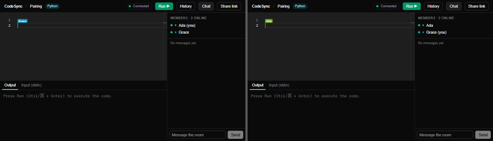
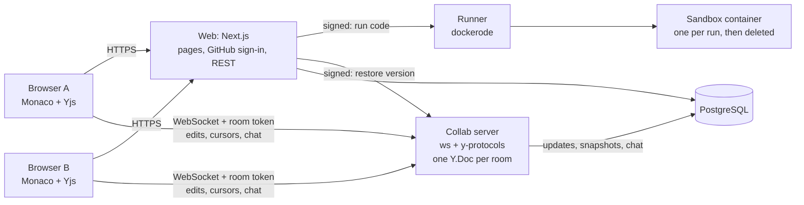

# CodeSync

A real-time collaborative code editor. Sign in with GitHub, create a room, share the link. Everyone
in the room edits the same file at once, sees each other's cursors, chats, and runs the JavaScript
or Python code in a locked-down sandbox.



> **Status:** everything below works and is tested locally and in CI. It is not deployed yet: the
> deploy configuration is written and tested in containers, and [docs/DEPLOY.md](docs/DEPLOY.md)
> has the steps that need your accounts.

## Features

- **Conflict-free editing** in Monaco with Yjs (CRDT). Offline edits merge on reconnect.
- **Presence:** coloured, named cursors and selections, a member list, connection status.
- **Chat** in the same document, so it syncs and persists with the code.
- **Persistence:** every room is saved to Postgres and survives crashes and deploys.
- **History:** preview any saved version read-only; the owner can restore one.
- **Run** JavaScript (Node 24) or Python (3.12) in a disposable container, with stdin.

## Architecture



| Path              | What                                                  |
| ----------------- | ----------------------------------------------------- |
| `apps/web`        | Next.js app: sign-in, rooms, editor UI, REST API      |
| `apps/collab`     | Collaboration server, written on `ws` + `y-protocols` |
| `apps/runner`     | Sandbox service that drives Docker                    |
| `packages/db`     | Prisma schema, migrations and client                  |
| `packages/shared` | Room tokens, request signing, limits and types        |
| `e2e`             | Playwright tests and the demo recorder                |
| `load`            | Measurement scripts and [results](load/results.md)    |

**How a room is saved.** Edits are merged into one row every 500 ms. After 200 rows, or when the
last person leaves, the rows are folded into a snapshot in one transaction. Joining an empty room
loads the latest snapshot plus any newer rows. Snapshots are the history; restoring one is applied
as a new edit, so everyone sees it live and it can itself be undone.

## Local setup

Requires Node 24+, pnpm 12 and Docker.

```bash
pnpm install
cp .env.example .env              # then fill in the secrets it lists
docker compose up -d postgres
pnpm db:generate
pnpm db:migrate
pnpm dev                          # web :3000, collab :1234, runner :4000
```

The first start downloads the two sandbox images.

### Signing in

- **GitHub:** create an OAuth app at <https://github.com/settings/developers> with the callback
  URL `http://localhost:3000/api/auth/callback/github`, then set `AUTH_GITHUB_ID` and
  `AUTH_GITHUB_SECRET` in `.env`.
- **Test users (local only):** set `AUTH_TEST_MODE=1` to get a "Sign in as test user" form that
  signs in by name. It is ignored when `NODE_ENV=production`, and the E2E tests rely on it.

## Security

**Running untrusted code.** Each run gets a new container that is always removed:

| Limit                                               | Stops                                |
| --------------------------------------------------- | ------------------------------------ |
| `--network=none`                                    | Data theft, attacks on other systems |
| `--memory=128m --memory-swap=128m`                  | Memory bombs                         |
| `--pids-limit=64`                                   | Fork bombs                           |
| `--cpus=0.5` and a 5 s wall-clock kill              | Infinite loops                       |
| `--read-only`, 16 MB `noexec` `/tmp`                | Tampering, filling the disk          |
| user 65534, `--cap-drop=ALL`, `no-new-privileges`   | Privilege escalation                 |
| No host mounts, no Docker socket, no secrets inside | Reading the host                     |
| 64 KB output, 100 KB code, 64 KB stdin              | Flooding the service                 |

Some hosts accept these flags and silently ignore them, so on startup the runner checks every one
from inside a probe container and refuses to run code if any is missing. The
[security suite](apps/runner/test/docker/security.test.ts) attacks real containers in CI.

**Between services.** The collab server rejects a WebSocket without a valid room token (a JWT that
lasts 5 minutes and is bound to one room) and, in production, from any other site. The runner and
the collab server's internal API accept only HMAC-signed requests less than 60 seconds old. Runs
are rate limited per user. Chat saved to the database is attributed to the verified token, not to
what the browser claims.

Containers share the host's kernel, so a kernel exploit could escape one. The runner should have a
machine to itself.

## Measured results

From [load/results.md](load/results.md), which also explains how each number is measured. Everything
ran on one laptop (i7-13700HX, 16 GB, Windows 11) over loopback, so **internet latency is not
included**.

| Metric                                                 | Result       |
| ------------------------------------------------------ | ------------ |
| Edit in A to visible in B, p50 / p95                   | 0.6 / 1.0 ms |
| 200 clients in one room, lost edits                    | 0 of 39,800  |
| 200 clients in one room, dropped connections           | 0            |
| 200 clients, edit to visible everywhere, p50 / p95     | 3.6 / 8.3 ms |
| `kill -9`, restart to first synced document, p50 / p95 | 607 / 664 ms |
| Documents intact after `kill -9`                       | 10 of 10     |
| JavaScript run, request to result, p50 / p95           | 288 / 346 ms |
| Python run, request to result, p50 / p95               | 274 / 315 ms |
| Sandbox security tests passed                          | 10 of 10     |

## Tests

```bash
pnpm format:check && pnpm lint && pnpm typecheck && pnpm test
pnpm --filter @codesync/runner test:docker    # sandbox security suite, real containers
pnpm e2e                                      # Playwright, real browsers
pnpm load                                     # regenerates load/results.md
pnpm --filter @codesync/e2e demo              # re-records docs/demo.gif
```

First time only: `pnpm --filter @codesync/e2e exec playwright install chromium`.

CI runs the checks, the E2E tests, the security suite, and tests of the images that get deployed
(they migrate, save open rooms when stopped, and enforce the sandbox limits).

## Known limitations

- **One collab process.** Rooms live in its memory, so people on two servers would not see each
  other live. Overlap during a deploy is safe: nothing is lost and browsers reconnect.
- **Up to 500 ms of edits can be lost on the server** if it is killed without warning. Connected
  browsers still hold them and send them again when they reconnect.
- **Presence names are self-reported.** A modified client could show a false name on its cursor.
- **No free host for the runner.** It needs Docker, so Run is off on the free deployment. The Fly.io
  setup is written but unproven: its nested Docker works in a privileged container, and Fly does
  not document it. A small VPS works too.
- **GitHub sign-in** is configured but has not been exercised end to end; tests use test users.
- Auth.js v5 is still a beta release.
- The chat panel and member list are hidden on narrow screens.
